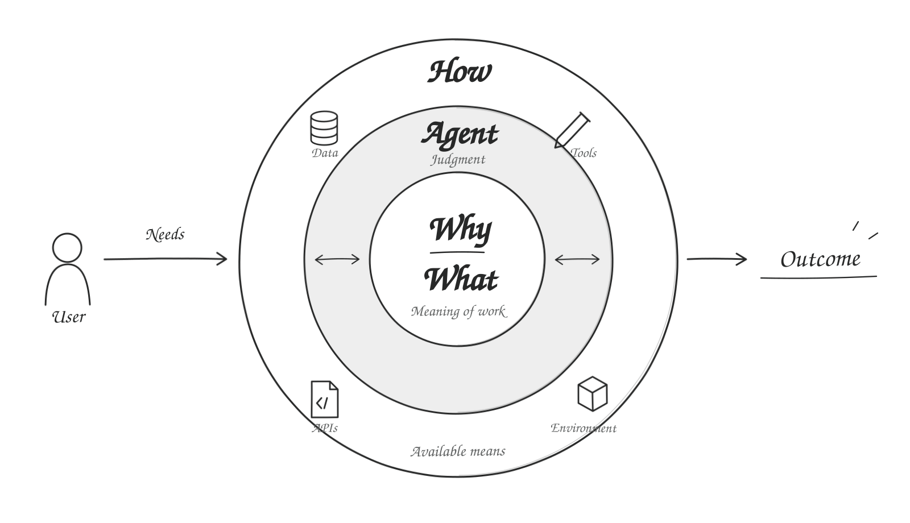

# ALPS — エージェントライフサイクルプロセススキル

[](https://github.com/mashimashica/alps/actions/workflows/validate.yml)
[](../../../LICENSE)

[English](../../../README.md)

<p align="center">
  
</p>

ALPSは、仕事を記述し、関係するプロセスをモデルにまとめ、それを実現するエージェント作業システムを設計するための体系です。なぜ行うのか、どの観察可能な状態を成功とするのか、どの境界と詳細が必要なのかを記述します。共有する情報の定義を通じて仕事をつなぎ、その仕事を有効に遂行するエージェント・ツール・情報資源・環境を設計します。

一度限りの依頼の明確化、既存Skillの改善、人やAgentが共同で行う仕事の再利用可能なプロセスモデルの作成に使えます。各プロセス記述は**名称、目的、成果**から始め、理解・適用・評価に影響する場合に詳細を加えます。

## 導入

ALPSはClaude、Cursor、Codexのアダプターを持つ[Agent Plugins](https://agent-plugins.org/)パッケージです。対応クライアントからPlugin全体を導入します。[`plugins` CLI](https://www.npmjs.com/package/plugins)では次を使用できます。

```console
npx plugins add mashimashica/alps
```

Claude Codeでは、このリポジトリをPluginマーケットプレイスとして追加し、そこから導入することもできます。

```text
/plugin marketplace add mashimashica/alps
/plugin install alps@alps
```

導入後は対象クライアントを再読込みしてください。各Skillは単体で機能します。組み合わせる場合は、仕事の記述をSkill間で受け渡します。Pluginは、三つのSkillとその参照資源を、参照資料である`examples/`とともに配布します。導入先で`design-process-description`、`design-agent-work-system`、`create-process-models`が表示され、それぞれの参照リンクを開けることを確認してください。

## Skillの使い方

| Skill | 設計・評価の対象 |
| --- | --- |
| [design-process-description](../../../skills/design-process-description/references/locales/ja/SKILL.ja.md) | プロセス記述の意味、関係、適用条件。 |
| [design-agent-work-system](../../../skills/design-agent-work-system/references/locales/ja/SKILL.ja.md) | エージェント・ツール・情報資源・実行環境の構成と相互作用。依頼範囲で実装・検証も含む。 |
| [create-process-models](../../../skills/create-process-models/references/locales/ja/SKILL.ja.md) | 関係するプロセスと共有する入出力定義を、一つのモデルPluginとしてまとめる。正本の作成と検証も含む。 |

二つの設計Skillは作成・改訂・レビューを支援し、それぞれ単体で機能します。設計の基礎となる情報が十分であれば、どちらからでも使えます。組み合わせる場合は、仕事の記述を受け渡します。プロセス記述をシステム設計の出発点にでき、システム設計はその記述の中で再検討が必要な前提を報告できます。仕事の記述には必要な方法や順序も含められます。自然言語で依頼するか、Hostの仕様に応じてSkill名を明示します。

```text
design-process-descriptionを使い、この一度限りの作業を、目的、観察可能な成功条件、必要な境界によって記述してください。

このプロセス記述をレビューしてください。不明確な成果、不必要な手段の固定、不足する参照、限界を識別し、書き換えずに指摘を返してください。

design-agent-work-systemを使い、この仕事に必要な能力とインターフェースを設計してください。適切なツールを再利用し、不足する処理を実装し、代表例で構成を検証してください。

このエージェント作業システムをレビューしてください。判断と処理の配分、情報供給、ツールのインターフェース、有効性の証拠を評価し、変更せずに指摘を返してください。
```

[最小テンプレート](../../../skills/design-process-description/references/locales/ja/SKILL-template.md)は、通常のAgent Skill frontmatterと、プロセスの三つの必須要素から始めます。[具体例](../../../skills/design-process-description/references/locales/ja/examples.md)では、最小の作業、一度限りの作業、固定成果物のない作業、必要な承認と順序、共有情報、ビュー、参照不足、成果を満たさない出力を扱います。

[実働例](../../../examples/locales/ja/README.md)では、一つのサービス評価Skillに対する二つの設計責務を示します。スクリプトが測定を検証して比較を計算し、エージェントが文脈を評価して証拠を解釈します。[システム設計の具体例](../../../skills/design-agent-work-system/references/locales/ja/examples.md)では、既存ツール、状態を変更する操作、能力変化への適応も扱います。

### プロセスモデルを作る

関係する仕事を再利用可能なモデルにまとめたい場合は、[create-process-models](../../../skills/create-process-models/references/locales/ja/SKILL.ja.md)を使います。対象の仕事、文脈、既存のプロセス記述があればそれらを渡してください。Skillはプロセスの境界を設計し、目的と観察可能な成功条件を記述し、共有する入出力を定義して、**一つのプロセスモデルを一つのAgent Pluginとして作成・検証**します。二つの設計Skillとは独立して使えます。

```text
create-process-modelsを使い、これらのサービス変更の記述を一つのモデルPluginにしてください。人とAgentが行う仕事を含め、共有する情報と成果物を定義し、パッケージを検証してください。前提と未解決事項も示してください。
```

作成するPluginでは、それぞれの定義を次の正本に置きます。

| 正本 | 内容 |
| --- | --- |
| `plugin.json` | パッケージの識別情報と、モデルの構成員の明示的な一覧。 |
| `skills/<name>/SKILL.md`または通常のプロセスMarkdown | プロセス記述の全文、明示的な`metadata.title`、型付きの`metadata.inputs` / `metadata.outputs`。Agent Skillは`SKILL.md`に置き、人の仕事には通常のMarkdownを使えます。 |
| `references/artifacts/<id>.md` | 入出力関係で使う情報項目・製品・サービスの共有定義。 |

関係には循環も含められます。入出力だけでは実行順序を指定しません。適用される基準・方針・要求の意味は原記述に保持します。[モデル形式](../../../skills/create-process-models/references/locales/ja/model-format.md)は、メタデータの符号化を含む正本の形式を定めています。具体的な成果物の配置と実行設定は、任意のワークスペース設定で扱います。パッケージの検査と意味のレビューは、モデル化した仕事の成功を示す証拠とは区別します。

## 設計思想

ALPSは、**システムズ／ソフトウェア工学に由来するプロセス記述**と、**小さく明確な道具を組み合わせるUnix哲学**をつなぎます。仕事の目的・成果・必要な作業や条件はプロセス記述で示し、確立した処理は道具として組み合わせられるようにします。

<p align="center">
  
</p>

仕事の意味（**Why / What**）と手段（**How**）を区別し、その間をエージェントの判断でつなぎます。確立した処理はツールに任せ、エージェントは目的と状況に応じて手段を選び、組み合わせ、必要に応じて方法を調整します。

仕事に必要な方法や順序は明示し、状況に依存する判断には裁量を残します。

## 資源

| 資源 | 英語 | 日本語 |
| --- | --- | --- |
| プロセス記述の意味 | [Process Framework](../../../skills/design-process-description/references/process-framework.md) | [プロセスフレームワーク](../../../skills/design-process-description/references/locales/ja/process-framework.md) |
| 作業システムの設計 | [Design principles](../../../skills/design-agent-work-system/references/agent-work-system-design.md) | [エージェント作業システムの設計原則](../../../skills/design-agent-work-system/references/locales/ja/agent-work-system-design.md) |
| プロセス記述の設計 | [Skill](../../../skills/design-process-description/SKILL.md) | [Skill](../../../skills/design-process-description/references/locales/ja/SKILL.ja.md) |
| エージェント作業システムの設計 | [Skill](../../../skills/design-agent-work-system/SKILL.md) | [Skill](../../../skills/design-agent-work-system/references/locales/ja/SKILL.ja.md) |
| プロセスモデルの作成 | [Skill](../../../skills/create-process-models/SKILL.md)、[model format](../../../skills/create-process-models/references/model-format.md) | [Skill](../../../skills/create-process-models/references/locales/ja/SKILL.ja.md)、[モデル形式](../../../skills/create-process-models/references/locales/ja/model-format.md) |
| 貢献とリポジトリ作業 | [CONTRIBUTING](../../../CONTRIBUTING.md)、[AGENTS](../../../AGENTS.md) | [CONTRIBUTING](CONTRIBUTING.md)、[AGENTS](AGENTS.md) |
| 版管理方針とリリースノート | [Versioning](../../../docs/versioning.md)、[0.9.0](../../../docs/releases/0.9.0.md) | [版管理](versioning.md)、[0.9.0](releases/0.9.0.md) |

## 版とライセンス

リポジトリ全体を一つの単位として版管理します。リリースの範囲と互換性については、上記の版管理方針とリリースノートを参照してください。

明示された第三者資料を除き、本リポジトリは[Apache License 2.0](../../../LICENSE)で提供します。[NOTICE](../../../NOTICE)も参照してください。
